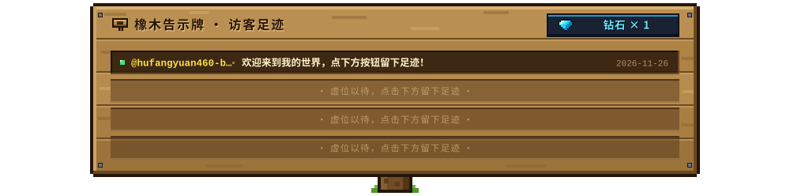
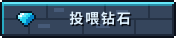
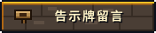

  
  

 

  

  

  

  

  
  &nbsp;&nbsp;
  

 

  <picture>
    <source media="(prefers-color-scheme: dark)" srcset="https://raw.githubusercontent.com/hufangyuan460-blip/hufangyuan460-blip/output/mc-snake-dark.svg" />
    <source media="(prefers-color-scheme: light)" srcset="https://raw.githubusercontent.com/hufangyuan460-blip/hufangyuan460-blip/output/mc-snake-light.svg" />
    
  </picture>

