  

## 关于我 · About

西南大学人工智能专业 2027 届本科生，方向是 **Java 后端**与 **AI 全栈**。
我做工具的方式是：先撞上真实的开发痛点，再把它做成自己每天会用的东西——不是跑完教程就搁着的 demo。

AI undergraduate at Southwest University, Class of 2027. I work on **Java backend** and **AI full-stack**, and I build tools from pain points I hit myself, not tutorial demos.

> 目前在找 2027 届 **后端 / AI 全栈**方向的正式岗位。 Open to full-time backend & AI full-stack roles, Class of 2027.

## 精选项目 · Selected Work

### [ThreadPath for Codex](https://github.com/hufangyuan460-blip/threadpath-for-codex)

一个与 Codex 官方客户端并行使用的桌面伴侣，用来翻查、整理并**分支探索**长会话历史。
A desktop companion that browses, organizes and branches long Codex conversation histories.

- 通过 stdio + JSONL / JSON-RPC 接入本地 Codex CLI `app-server`，不替代官方客户端的编码与审批流程
- 工作区分组、全文检索、收藏、归档；长会话的回合目录与虚拟列表
- 可以从已结束的一轮分叉出替代方案，同时保留原讨论路径
- 已发 Windows x64 Beta，带 GitHub Actions 自动打包

`Electron` `React` `TypeScript` `Vite` `pnpm`

### [AI Zero Code Hub Plus](https://github.com/hufangyuan460-blip/ai-zero-code-hub-plus)

用自然语言生成网页应用的全栈平台。
A full-stack platform that turns natural language into runnable web apps.

- 三种生成模式：原生 HTML、原生多文件、Vue 工程；流式对话逐段输出，支持持续修改与增量生成
- Vue 工程模式下给模型提供文件读写、修改、删除、目录查看等工具能力
- 生成结果可在线预览、部署、下载源码；Redis 存短期对话记忆，MySQL 持久化历史

`Spring Boot 3` `MyBatis-Flex` `MySQL` `Redis` `Caffeine` `Vue 3`

### [拾页 Shiyue](https://github.com/hufangyuan460-blip/Shiyue-app) · 实体书阅读记录

一款 Android 应用，围绕"拿起一本书 → 专注阅读 → 记录页码与随记 → 回看阅读轨迹"设计。
An Android app for people who read physical books: pages, sessions and marginalia.

- ISBN 扫描或手动录入，按页码计算阅读进度，随记与页码关联
- 数据完全本地保存，支持备份与恢复；交互上强调克制与仪式感

`Kotlin` `Android`

### [Windows Terminal for PI-Desktop](https://github.com/hufangyuan460-blip/windows-terminal-for-pi-desktop)

给 PI-Desktop 的工作面板加一个**真正的** Windows 交互式终端。
A real ConPTY terminal plugin for PI-Desktop's work panel.

- `xterm.js` 前端 + 自写 ConPTY 辅助程序（C# / .NET 8，自包含单文件），无需 Node / Python / .NET 运行时
- 每个标签独立伪终端与 Shell 进程，标签之间互不串流；UTF-8 中文、IME、含空格路径均可用
- 终端内容不交给 AI：命令以你自己的身份在真实控制台执行

`JavaScript` `C#` `ConPTY` `xterm.js`

私有项目：毕业论文《多智能体对抗学习》——追逐-逃避场景下 IDDPG 与 MADDPG 的对比（TorchRL + VMAS）；以及个人 Life OS。

[→ 全部仓库 / All repositories](https://github.com/hufangyuan460-blip?tab=repositories)

## 技术栈 · Stack

| | |
|---|---|
| **后端 Backend** | `Java` `Spring Boot 3` `MyBatis-Flex` `MySQL` `Redis` `Kafka` `Linux` |
| **前端 Frontend** | `Vue 3` `React` `TypeScript` `Vite` `Electron` |
| **AI / Agent** | `LLM 应用` `Agent 工程` `SSE 流式` `Codex app-server` `RAG` |
| **工程 Engineering** | `Docker` `Git` `GitHub Actions` `pnpm` |

## 现在 · Now

- 写毕业论文：追逐-逃避场景下 **IDDPG / MADDPG** 的对抗学习对比
- 迭代 **ThreadPath for Codex**，把它做成能日常用的 Codex 历史工作台
- 维护 PI-Desktop 的 ConPTY 终端插件
- 学习路线：AI Agent 工程化与 AI Native 的软件工程实践

---

持续构建、持续学习 · 把 AI 当成长期认知杠杆

