<div align="center">
  
</div>

```yaml
gamemode: creative / survival

hotbar:
  - redstone-circuits      # AI Agents & automation
  - command-blocks         # Java / TypeScript / Electron
  - pixel-shaders          # Code animation & visual craft
  - enchanted-pickaxe      # Daily-driver dev tools

worlds:
  - threadpath-for-codex   # Branching timelines for Codex sessions
  - ai-zero-code-hub-plus  # Prompt-to-app workbench
  - shiyue-app             # Quiet reading log for paper books
  - pi-desktop-terminal    # Real ConPTY terminal block

status: "Teaching AI villagers to wire redstone machines at 2 AM."
```

<div align="center">
  <picture>
    <source media="(prefers-color-scheme: dark)" srcset="https://raw.githubusercontent.com/hufangyuan460-blip/hufangyuan460-blip/output/mc-snake-dark.svg" />
    <source media="(prefers-color-scheme: light)" srcset="https://raw.githubusercontent.com/hufangyuan460-blip/hufangyuan460-blip/output/mc-snake-light.svg" />
    
  </picture>
</div>
